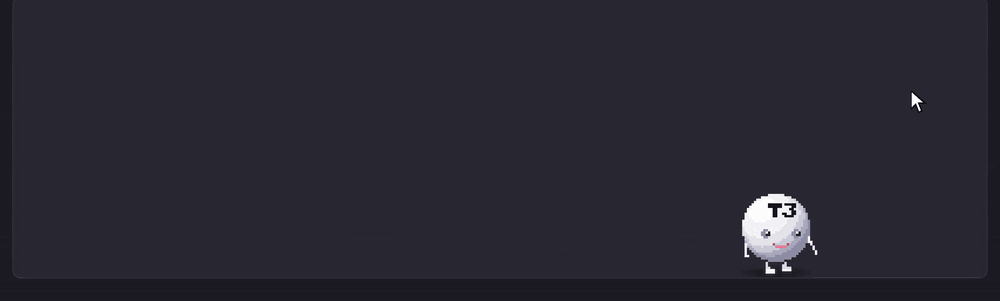
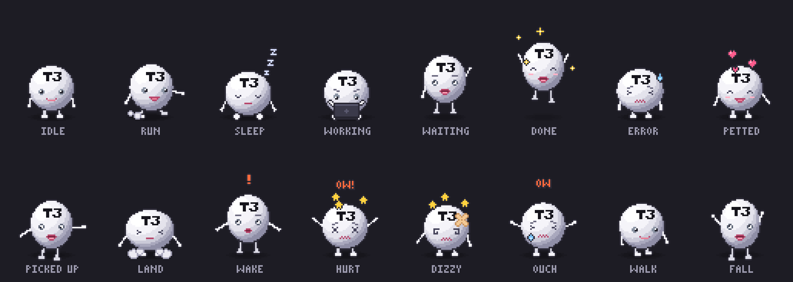

# t3-pet

A pixel-art T3 mascot that lives on your desktop, follows your cursor and shows what your
[T3 Code](https://github.com/pingdotgg/t3code) agents are doing. He types on a laptop while an agent works,
waves when it needs you, and jumps when it's done. You can also pick him up, pet him, and (please don't)
throw him into the wall.



This is a fan project, not an official T3 Code feature.

## Run it

```
git clone https://github.com/kausthubh-coder/t3-pet
cd t3-pet
npm install
npm start
```

It's an Electron app in plain JavaScript with no build step. Tested on Windows 11. macOS and Linux should
work but haven't been tried. Quit from the tray icon.

To look at the art without Electron, serve the folder (for example `npx http-server .`) and open
`preview.html`. It shows every animation and a playground that runs the same pet code as the app.

## What he does



- He lives in a transparent, click-through window on top of everything, on whichever monitor your cursor
  is on. Clicks only stop at the pet itself.
- He walks after your cursor, or runs if it's far away, and stands on the bottom edge of the screen.
  After 30 seconds without cursor movement he sits down and falls asleep. Moving the mouse wakes him.
- Click him for hearts. Drag him and let go to drop him.
- Throw him hard into a screen edge, or drop him from high up, and he goes "OW!", sees stars and wears a
  bandage for 20 seconds. Three quick clicks make him cry, and five knock him out. A gentle click ends
  the sulk.
- The tray menu has Pause following, Pet it, Go to sleep, a state picker and Quit.

## How he knows what your agent is doing

Once a second the app reads T3 Code's local database, `~/.t3/userdata/statev2.sqlite`. It opens the
file read-only and only runs `SELECT` queries (`src/status/queries.js`), so it can't change anything in
T3 Code.

| Pet shows | When |
|---|---|
| waiting ("?") | a run is still going and has a request waiting on you |
| error | a run failed in the last 6 seconds |
| done | a run completed in the last 6 seconds |
| working | a run is going |
| idle | none of the above |

The checks run in that order. The app ignores runs on archived or deleted threads, and "running" rows
more than 6 hours old, which a crash can leave behind. The bubble shows the thread title for a few
seconds after a change, and while you hover the pet.

If Electron can't load `node:sqlite`, the app runs `src/status/poll-child.js` with your system `node`
instead. If the database doesn't exist, the pet still runs and you can set his mood with the hotkeys.

Overrides: `T3_STATE_DB` sets the database path, `T3PET_SQLITE=child` forces the fallback poller and
`T3PET_NODE` points it at a specific node binary.

## Hotkeys

These force a mood, which is handy for recording a demo.

| Keys | Mood |
|---|---|
| Ctrl+Alt+1 | idle |
| Ctrl+Alt+2 | working |
| Ctrl+Alt+3 | waiting on you |
| Ctrl+Alt+4 | done (about 6 seconds) |
| Ctrl+Alt+5 | error (about 6 seconds) |
| Ctrl+Alt+0 | back to live T3 status |

## Scripts

- `scripts/peek-status.mjs` prints the status the pet would show right now, from your real T3 database.
- `scripts/make-sheet.mjs` regenerates `assets/animations.png`.
- `scripts/demo-drive.js` drives the `preview.html` playground for screen recordings (it made the GIF above).
- `scripts/start.js` is what `npm start` runs. It clears `ELECTRON_RUN_AS_NODE` first, because terminals
  opened from T3 Code set it and Electron would otherwise start as plain Node.

## License

MIT
